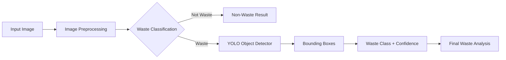
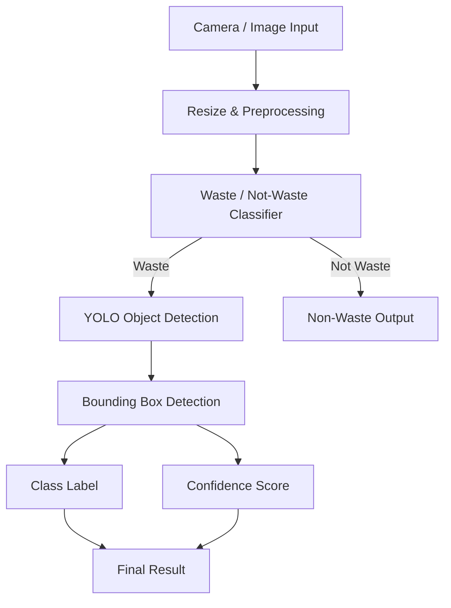

# ♻️ Intelligent Waste Detection & Classification

An AI-based waste analysis project that combines **image classification** and **YOLO-based object detection** to identify waste and classify different waste materials.

The project is designed with a practical deployment goal: first determine whether an image contains **waste or non-waste**, and then use object detection to identify the type and location of waste objects.

---

## ✨ Highlights

- 🤖 Deep-learning based waste analysis
- 🔍 Binary **waste / not-waste** classification
- 🎯 YOLO object detection for multiple waste categories
- 📦 Bounding-box based localization
- 📊 Precision, Recall, F1, PR and confidence-curve evaluation
- 🧮 Confusion-matrix analysis
- 📈 Training and validation loss/metric visualization
- 🖥️ Suitable for experimentation and edge-deployment research

---

## 🧠 Project Overview

The project contains two complementary stages:



### Stage 1 — Waste Classification

The classifier predicts whether the input image represents:

- `waste`
- `not_waste`

The supplied prediction examples show high-confidence predictions for both categories.

### Stage 2 — Waste Object Detection

The YOLO detector identifies individual waste objects and assigns a class label and bounding box.

The evaluated detector contains **7 waste classes**:

| ID | Class |
|---:|---|
| 0 | Aluminium |
| 1 | Glass |
| 2 | Tag |
| 3 | cardboard |
| 4 | rigid_plastic |
| 5 | soft_plastic |
| 6 | wood |

---

## 📊 YOLO Model Results

The supplied evaluation plots report the following overall detection performance:

| Metric | Result |
|---|---:|
| Precision | ~0.85 |
| Recall | ~0.75 |
| mAP@0.5 | **0.827** |
| mAP@0.5:0.95 | **~0.726** |
| Best overall F1 | **~0.81** |

> Values above are read from the supplied YOLO training/evaluation plots. Exact values should be taken from the original `results.csv` if a more precise numerical table is required.

### Per-Class AP@0.5

| Class | AP@0.5 |
|---|---:|
| Aluminium | 0.880 |
| Glass | **0.910** |
| Tag | 0.866 |
| cardboard | 0.677 |
| rigid_plastic | 0.842 |
| soft_plastic | 0.620 |
| wood | **0.995** |

**Best performing classes:** `wood`, `Glass`, and `Aluminium`.

**Classes needing further improvement:** `soft_plastic` and `cardboard`.

---

## 📈 Training Results

The training curves show continuous improvement in the detector during training.

- Training box loss decreases steadily.
- Training classification loss decreases steadily.
- DFL loss decreases over training.
- Validation losses generally decrease.
- Precision and recall improve during training.
- mAP@0.5 increases throughout training.
- mAP@0.5:0.95 also shows a consistent upward trend.


---

## 🎯 Precision–Recall Analysis

The Precision–Recall curve gives an overall **mAP@0.5 of 0.827**.


The class-wise curves show that `wood` performs particularly strongly, while `soft_plastic` and `cardboard` are comparatively more difficult classes.

---

## 📉 Confidence Curves

### F1–Confidence

The overall F1 curve reaches approximately **0.81 at a confidence threshold around 0.445**.


### Precision–Confidence

Precision increases with confidence and approaches 1.0 at high confidence thresholds.


### Recall–Confidence

Recall is highest at low confidence thresholds and gradually decreases as the confidence threshold becomes stricter.


---

## 🧮 Confusion Matrix

The confusion matrix provides class-level insight into correct predictions and misclassifications.


The supplied matrix indicates stronger recognition for classes such as `cardboard`, while `soft_plastic`, `rigid_plastic`, and some other categories show more confusion. The large background-related counts also indicate that background/false-positive handling is important for further improvement.

---

## 📦 Dataset Distribution

The supplied label analysis shows the following number of annotated instances:

| Class | Instances |
|---|---:|
| Aluminium | 1,357 |
| Glass | 1,112 |
| Tag | 1,922 |
| cardboard | 13,481 |
| rigid_plastic | 3,467 |
| soft_plastic | 5,259 |
| wood | 185 |


### Dataset Observation

The class distribution is highly imbalanced. In particular:

- `cardboard` has the largest number of instances.
- `wood` has the smallest number of instances.
- `soft_plastic` and `rigid_plastic` contain substantially more examples than `wood`.

This imbalance should be considered when interpreting per-class performance.

---

## 🖼️ Detection / Classification Examples

The supplied prediction examples demonstrate the binary classifier producing predictions such as:

- `waste` with confidence around **85–89%**
- `not_waste` with confidence around **91–100%**


These examples include both waste and non-waste scenes and demonstrate the intended classification behavior.

---

## 🏗️ System Architecture



---

## 🔄 Detection Pipeline

1. **Input** — Capture or provide an image.
2. **Preprocessing** — Resize and prepare the image for inference.
3. **Classification** — Determine whether the image contains waste.
4. **Detection** — Run YOLO on waste-containing images.
5. **Localization** — Generate bounding boxes around detected objects.
6. **Classification** — Assign the detected waste category.
7. **Confidence** — Calculate prediction confidence.
8. **Output** — Display the final result.

---

## 🧪 Model Evaluation

The project evaluates the detector using:

- **Precision**
- **Recall**
- **F1-score**
- **mAP@0.5**
- **mAP@0.5:0.95**
- **Precision–Recall curves**
- **Confidence curves**
- **Confusion matrix**
- **Training/validation loss curves**

These metrics provide a more complete evaluation than accuracy alone, which is particularly important for object-detection problems.

---

## 📁 Recommended Repository Structure

```text
intelligent-waste-detection/
│
├── README.md
├── requirements.txt
├── data/
│   └── dataset.yaml
│
├── models/
│   ├── classifier/
│   └── detector/
│
├── notebooks/
│   └── training.ipynb
│
├── src/
│   ├── classification/
│   ├── detection/
│   ├── preprocessing/
│   └── inference/
│
├── assets/
│   ├── BoxF1_curve.png
│   ├── BoxP_curve.png
│   ├── BoxPR_curve.png
│   ├── BoxR_curve.png
│   ├── confusion_matrix.png
│   ├── labels.jpg
│   ├── results.png
│   └── demo_predictions.png
│
└── weights/
    └── best.pt
```

---

## ⚙️ Installation

Clone the repository:

```bash
git clone <YOUR_REPOSITORY_URL>
cd intelligent-waste-detection
```

Create a virtual environment:

```bash
python3 -m venv .venv
source .venv/bin/activate
```

Install dependencies:

```bash
pip install -r requirements.txt
```

---

## 🚀 YOLO Inference

Example inference command:

```bash
yolo predict \
    model=weights/best.pt \
    source=path/to/image.jpg \
    conf=0.25
```

Replace `weights/best.pt` with the path to your trained YOLO model.

---

## 🏋️ YOLO Training

Example training command:

```bash
yolo detect train \
    model=yolov8n.pt \
    data=data/dataset.yaml \
    epochs=50 \
    imgsz=640 \
    batch=16
```

Adjust the training parameters according to your hardware and dataset.

---

## 🖥️ Deployment Direction

The project can be extended toward real-time deployment using:

- Raspberry Pi
- USB / CSI camera
- Lightweight YOLO models
- Optimized inference runtimes
- Real-time waste monitoring interfaces

A lightweight detector is especially useful for edge devices where computational resources are limited.

---

## 🔬 Research Opportunities

Potential improvements include:

- Addressing class imbalance using targeted augmentation.
- Increasing the number of `wood` examples.
- Improving `soft_plastic` and `cardboard` detection.
- Adding more diverse outdoor and real-world images.
- Testing YOLOv8n against other lightweight detectors.
- Hyperparameter optimization.
- Confidence-threshold optimization.
- Model quantization for edge deployment.
- Raspberry Pi real-time benchmarking.
- Measuring FPS, latency, memory usage, and power consumption.

---

## 📌 Current Limitations

Based on the supplied evaluation:

1. The dataset is significantly class-imbalanced.
2. `wood` has relatively few training instances.
3. `soft_plastic` has comparatively low AP@0.5.
4. `cardboard` performance is lower than the strongest classes.
5. Background detections contribute significantly to the confusion matrix.
6. Real-time hardware performance still needs to be benchmarked separately.

---

## 🏆 Key Results

> **Overall mAP@0.5: 0.827**

> **Best class AP@0.5: wood — 0.995**

> **Second-best class AP@0.5: Glass — 0.910**

> **Overall best F1: ~0.81**

These results demonstrate that the detector can recognize several waste categories effectively, while also highlighting areas where additional data and training improvements are needed.

---

## 👨‍💻 Project Status

**Status:** 🚧 Active Development

The current version focuses on model training, evaluation, visualization, and the foundation for practical waste-detection deployment.

---

## 📜 License

Add your preferred open-source license here, for example:

```text
MIT License
```

---

## ⭐ Contributing

Contributions are welcome.

1. Fork the repository.
2. Create a feature branch.
3. Make your changes.
4. Test the changes.
5. Open a pull request.

---

## 📬 Contact

For questions, collaboration, or research discussions, open an issue in this repository.
